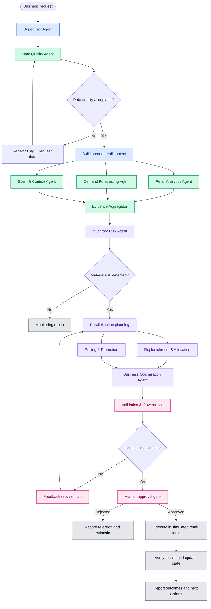
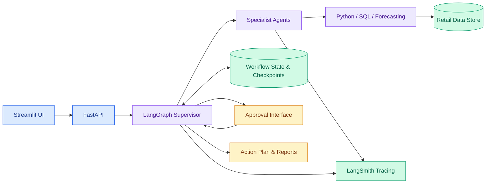

# Retail Multi-Agentic System POC — Architecture and Implementation Plan

## Overview

Build a **Retail Intelligence and Autonomous Operations Co-Pilot** that analyzes sales, predicts demand, identifies operational risks, evaluates alternatives, and coordinates decisions across inventory, pricing, promotions, and store operations.

The POC should demonstrate complex orchestration: **shared state, conditional routing, parallel execution, tool usage, feedback loops, checkpointing, human approval, and outcome verification**. The supplied retail dataset is the foundation, supplemented by clearly labeled simulated data where necessary.

## 1. Business problems to address

| # | Problem | Agentic capability | Data needed |
|---|---|---|---|
| 1 | Demand forecasting and stockout prevention | Forecast demand, detect stockout risk, estimate lost sales, recommend replenishment | `units_sold`, `stock_on_hand`, `month`, `price`, `climate_*`, `holiday_*` |
| 2 | Inventory allocation across stores | Detect surplus and shortage, recommend feasible transfers | Inventory snapshots, transfer costs, lead times |
| 3 | Pricing and promotion optimization | Diagnose weak sales, evaluate discounts and promotional timing | `price`, `units_sold`, `revenue`, `month`, events, product costs |
| 4 | Store performance diagnosis | Investigate poor store/category performance and possible drivers | Store, city, category, sales, revenue, weather, holidays |
| 5 | Supplier and replenishment coordination | Prioritize purchase orders, detect delivery risks | Supplier, purchase-order, lead-time and delivery records |
| 6 | Weather, holiday, and event planning | Forecast event-driven demand and prepare store-specific plans | Climate, holiday and custom-event fields |
| 7 | Autonomous exception management | Detect anomalies, investigate, propose actions, obtain approval, verify outcomes | Core dataset plus relevant operational data |

**Recommended integrated POC:** Combine problems **1, 2, 4, 6 and 7** into a single workflow rather than disconnected demos.

## 2. Specialized agents

Use **10 specialized agents** coordinated by a central Supervisor/Orchestrator. These are logical roles, not necessarily ten different LLMs. Use deterministic Python, SQL, forecasting, and optimization tools for calculations.

| # | Agent | Responsibilities |
|---|---|---|
| 1 | **Supervisor / Orchestrator** | Interpret request, plan tasks, delegate, route failures, track dependencies and shared state, enforce approval gates |
| 2 | **Data Quality** | Validate missing values, duplicates, price/revenue consistency, synthetic rows and calendar coverage; request repairs or flag limitations |
| 3 | **Retail Analytics** | Query sales, revenue, store/category trends, seasonality and anomalies using SQL/Python |
| 4 | **Demand Forecasting** | Invoke forecasting models, estimate future demand and uncertainty, identify spikes/drops |
| 5 | **Inventory Risk** | Evaluate stockout/excess-stock risk, stock cover and potential lost sales |
| 6 | **Replenishment and Allocation** | Recommend purchase quantities and inter-store transfers subject to operational constraints |
| 7 | **Event and External Context** | Analyze holidays, weather, local events and seasonal demand; enrich with approved external sources |
| 8 | **Pricing and Promotion** | Assess price/promotion alternatives against revenue, margin, demand and policy constraints |
| 9 | **Business Planning and Optimization** | Rank and combine candidate actions under budget, service-level and feasibility constraints |
| 10 | **Validation and Governance** | Check evidence, calculations, constraints, duplicate recommendations, action limits and approvals; verify outcomes |

## 3. Complex orchestration

### Primary scenario: Protect next month's retail revenue

> Identify stores likely to lose sales next month because of insufficient stock. Investigate why, recommend stock transfers or replenishment, account for upcoming holidays and weather, and produce a prioritized action plan within a budget.



### Orchestration features to demonstrate

- **Parallel execution:** Analytics, forecasting and event analysis execute concurrently after data validation.
- **Conditional routing:** Branch based on data quality, risk severity and feasibility.
- **Dynamic delegation:** Invoke specialist investigations only when relevant.
- **Iterative optimization:** Revise plans when budget, supplier, capacity or stock constraints fail.
- **Shared state:** Maintain request, evidence, forecasts, candidate actions, constraints and approval status.
- **Human-in-the-loop:** Do not apply consequential changes without required approval.
- **Outcome verification:** Record execution and compare observed or simulated outcomes with expectations.

**Design rule:** Use typed shared state and structured tool outputs, not unstructured conversations as the principal interface between agents.

## 4. Dataset strategy

### 4.1 Supplied columns

```text
source entity_type native_store_id native_product_id store_key product_key
units_sold price stock_on_hand is_synthetic rn_category city state
store_name pincode city_tier month climate_temp_mean climate_temp_max
climate_rain_mm climate_observation_days climate_rain_regime
national_holiday_count state_holiday_count holiday_flag
holiday_calendar_covered custom_event_flag custom_event_calendar_covered
revenue
```

| Columns | Purpose |
|---|---|
| `native_store_id`, `store_key`, `store_name` | Store identification and performance |
| `native_product_id`, `product_key`, `rn_category` | Product and category analysis |
| `units_sold`, `price`, `revenue` | Sales analytics, forecasting and price analysis |
| `stock_on_hand` | Inventory risk and replenishment |
| `month` | Seasonality and time-series analysis |
| `city`, `state`, `pincode`, `city_tier` | Regional demand and segmentation |
| `climate_temp_mean`, `climate_temp_max`, `climate_rain_mm` | Weather-demand relationships |
| `climate_observation_days`, `climate_rain_regime` | Weather context and coverage |
| `national_holiday_count`, `state_holiday_count`, `holiday_flag` | Holiday-driven demand |
| `holiday_calendar_covered`, `custom_event_calendar_covered` | Reliability of calendar features |
| `custom_event_flag` | Local event context |
| `is_synthetic`, `source`, `entity_type` | Data provenance and record classification |

**Validate first:** Determine the row grain (for example product-store-month), the meaning and timing of `stock_on_hand`, and uniqueness of identifiers. Monthly sales plus month-end stock do not reveal daily stockouts or inventory movements. Check whether `revenue = units_sold × price`; differences can be legitimate if `price` is not the realized transaction price.

### 4.2 Additional data to simulate or integrate

1. **Inventory movements:** Opening stock, receipts, transfers, adjustments, closing stock, stockout days.
2. **Suppliers and purchase orders:** Supplier ID, lead time, unit cost, minimum order quantity, delivery status, capacity.
3. **Commercial constraints:** Product margin, replenishment budget, transfer costs, shelf capacity, discount limits.
4. **Daily sales and events (optional):** Daily sales, promotions, product launches, local event calendar.

Keep simulated data distinguishable from real observations. Simulated benefits are not evidence of real-world financial outcomes.

## 5. Technical architecture



| Layer | Recommended choice |
|---|---|
| Orchestration | LangGraph |
| Agent tools and model interface | LangChain |
| LLM | Groq hosted inference or Ollama local inference |
| Data processing | Pandas, NumPy, SQL |
| Forecasting | Statsmodels, scikit-learn, optionally gradient boosting |
| Optimization | SciPy or OR-Tools |
| Data storage | CSV initially; SQLite or PostgreSQL for persistence |
| API | FastAPI |
| UI | Streamlit |
| Observability | LangSmith |
| Testing | pytest, scenario-based tests and forecast-error metrics |

Use a common model factory for Groq/Ollama to avoid changing agent logic when switching providers.

## 6. Four-week implementation plan

### Week 1 — Data and baseline intelligence

**Goal:** Establish reliable business evidence.

- Inspect row grain, schema, missing values, duplicates and synthetic rows.
- Build a clean product-store-month analytical dataset.
- Implement sales, revenue, inventory-risk and seasonality queries.
- Implement Data Quality and Retail Analytics agents.
- Establish a non-agent demand-forecast baseline.

**Deliverable:** Clean dataset, analytical tools and baseline metrics.

### Week 2 — Multi-agent orchestration

**Goal:** Build shared-state and conditional decision workflows.

- Implement Supervisor, Forecasting, Inventory Risk and Event agents.
- Create parallel branches for analytics, forecasting and event context.
- Add conditional routing, retries, timeouts and checkpointing.
- Enforce structured outputs and evidence references.

**Deliverable:** End-to-end workflow identifying and explaining inventory risks.

### Week 3 — Planning and feedback loops

**Goal:** Turn risks into feasible, prioritized actions.

- Add replenishment, stock-transfer and pricing agents.
- Create simulated supplier and commercial datasets.
- Implement budget-constrained optimization.
- Add validation, plan revision and human approval.
- Implement simulated action tools with audit logging.

**Deliverable:** Complete proposed-action and approval workflow.

### Week 4 — Interface and evaluation

**Goal:** Demonstrate value compared with simpler approaches.

- Build Streamlit screens for requests, agent traces and recommendations.
- Expose workflow through FastAPI.
- Add LangSmith tracing, test scenarios and failure injection.
- Compare against a single-agent baseline and deterministic rules.
- Demonstrate approval, execution, verification and audit history.

**Deliverable:** Demonstrable, evaluated POC.

## 7. First end-to-end demonstration

> Analyze next month's inventory risk across all stores. Identify the 10 highest-risk product-store combinations, explain likely drivers, and propose the lowest-cost feasible mitigation plan within a **₹5 lakh replenishment budget**. Account for upcoming holidays and weather. Do not execute anything without approval.

**Expected outputs:**

1. Ranked list of at-risk product-store combinations.
2. Forecast demand, available stock and risk rationale.
3. Evidence-backed findings with uncertainties and hypotheses identified.
4. Recommended transfers, replenishment orders or alternatives.
5. Expected costs and estimated sales protected, with uncertainty.
6. Budget- and supplier-feasible action plan.
7. Approval screen, simulated execution results and audit trail.

The ₹5 lakh budget is an illustrative scenario parameter.

## 8. Success metrics

| Metric | Evaluation |
|---|---|
| Forecast accuracy | WAPE or MAE on time-held-out sales |
| Risk detection | Precision/recall against labeled or simulated stockout scenarios |
| Feasibility | Percentage of plans satisfying stock, budget and supplier constraints |
| Business value | Simulated margin, sales protected and holding/transfer costs |
| Workflow reliability | Completion rate, invalid transitions, tool failures |
| Evidence quality | Percentage of material claims supported by data/tool outputs |
| Orchestration value | Compare with a single-agent baseline and deterministic rules |
| Safety | No unapproved actions; verified audit/rejection handling |

Use time-based train/test splits for monthly records. If historical coverage is short, treat forecasting results as preliminary and supplement with controlled scenarios.

## 9. POC scope and design decisions

**Include:** Data quality, analytics, demand forecasts, inventory risk, event context, replenishment planning, constrained optimization, validation, human approval, simulated execution, monitoring and tracing.

**Exclude initially:** Live purchase-order creation, real price updates, customer-level personalization and full ERP integration.

Avoid turning every analytical task into an LLM prompt. Keep numeric computation in deterministic tools; use agents for investigation selection, coordination, interpretation and planning.

## 10. Recommended next implementation step

Define the **LangGraph nodes and edges**, **shared state schema**, **agent input/output contracts**, **tool interfaces**, **checkpoint strategy**, and **first runnable project skeleton**. Start with the integrated inventory-risk scenario and extend it into the broader Retail Operations Co-Pilot.
